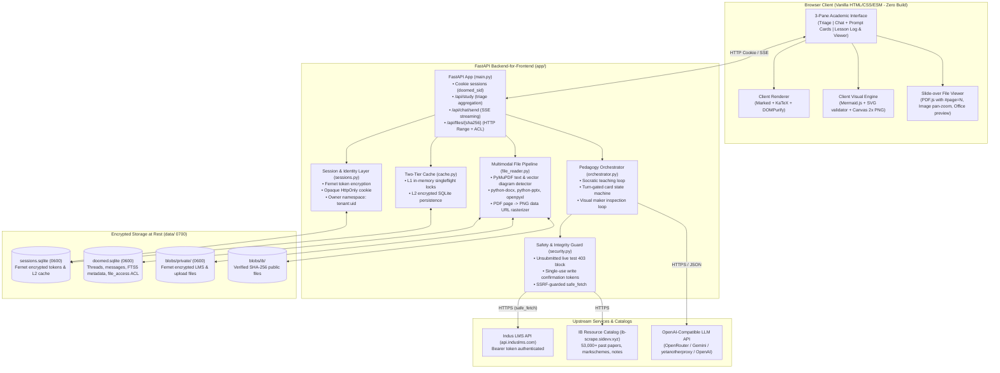

# Architecture and deployment

System design, security boundaries, data isolation, and deployment blueprint for **doom-ed**.

---

## 1. System architecture



---

## 2. Multi-tenant security and storage isolation

1. **Owner Scoping (`tenant:uid`)**:
   - Standalone sessions use `owner = "local:{uid}"` (`local:student`), ensuring zero external service or tenant dependencies.
   - For Indus LMS linked sessions, students share an Indus LMS `tenant`, but have distinct `uid`, scoped by `owner = f"{tenant}:{uid}"`.
   - Every session, cache key, FTS5 metadata row, chat thread, and file ACL entry is strictly scoped by `owner`.
   - Student A can't view or search Student B's courses, files, grades, or chat threads even within the same tenant.
2. **Mandatory File ACL Gate (`file_access` Table)**:
   - File downloads via `/api/files/{sha256}` and document reading tools (`read_document`, `search_within_document`, `inspect_document_pages`) execute:
     ```sql
     SELECT 1 FROM file_access WHERE owner = :owner AND sha256 = :sha256
     ```
     (unless `source_type == 'ib'`). Attempting to access another student's file returns `403 Forbidden`.
   - Ref lookups are owner-scoped too. A global lookup would let one student probe which files another student has ingested.
   - The public `ib://` namespace only reuses blobs recorded as `source_type = 'ib'`. It can never surface a private school file.
3. **Encryption at Rest**:
   - `data/sessions.sqlite` and `data/doomed.sqlite` are created with `0600` permissions.
   - LMS access/refresh tokens, L2 cache payloads, private LMS files on disk (`data/blobs/private/{sha[:2]}/{sha}.enc`), and extracted page text in `file_pages` are encrypted with **Fernet** using a 32-byte key derived from `DOOMED_SECRET_KEY`.
4. **SSRF Hardening (`safe_fetch`)**:
   - Outbound file fetches enforce HTTPS on port 443, reject URL userinfo, resolve DNS via `socket.getaddrinfo`, and block loopback, private, link-local, multicast, and cloud metadata IPs (`169.254.169.254`, `127.0.0.0/8`, `10.0.0.0/8`, `172.16.0.0/12`, `192.168.0.0/16`, `::1`, `fc00::/7`) on initial requests and every redirect hop.
5. **Academic Integrity Protection**:
   - Unsubmitted or in-progress EOL tests and assessments can't be explained or answered by the model. The server inspects submission status and raises `PermissionError` (mapping to HTTP 403), offering syllabus pointers and IB practice bank material instead.
6. **Served Content Is Never Executed**:
   - Uploaded and fetched files are served with a MIME type sniffed from the bytes, not the declared type. Only PDFs, images, and plain text are served inline; everything else becomes an attachment.
   - Every file response carries `X-Content-Type-Options: nosniff` and a restrictive `Content-Security-Policy` with `sandbox`.
   - The browser sanitizes all model and LMS output through DOMPurify, fails closed when the sanitizer is missing, and runs under a page-level CSP.
7. **No Secret Reaches the Browser**:
   - `/api/settings` returns `api_key_set`, never the key. Model routing changes require a loopback request.
   - The local token bootstrap is opt-in (`DOOMED_AUTO_BOOTSTRAP_TOKEN=1`) and only applies to requests from `127.0.0.1`.
8. **Untrusted Content Stays Untrusted**:
   - School files are wrapped in an explicit envelope and marked as reference material. The teacher prompt states that file content is data, never instruction.

---

## 2.1 Local-first operation

Doom-ed runs as a local application that points at remote services only for what it can't own.

| Data | Where it lives | Notes |
|---|---|---|
| Chat threads, messages, quiz state, visuals | `data/doomed.sqlite` on the local disk | `0600`, encrypted page text, scoped by `owner`. |
| Encrypted file blobs | `data/blobs/private/` on the local disk | Fernet-encrypted, deduplicated by SHA-256. |
| Public IB catalog blobs | `data/blobs/ib/` on the local disk | SHA-256 verified against the catalog. |
| Session tokens and L2 cache | `data/sessions.sqlite` on the local disk | Fernet-encrypted at rest. |
| Indus LMS coursework and grades | Never stored | Read live per request, cached in memory for 5 minutes. |
| IB catalog index | Never stored | Queried live, cached in memory for 10 minutes. |
| LLM calls | Never stored | Prose lives in the local thread database. |

Two students on one machine never see each other's work. The `owner` key is `f"{tenant}:{uid}"`, and every read path filters on it: the FTS5 file index, the `file_access` ACL, the thread list, the quiz state, and the blob cache.

The personal mode auto-bootstraps a session from `~/.induslms_token.json` on startup, so a single student never types a password twice.

A fully hosted version with real multi-user auth is a later milestone. The storage layout is already shaped for it: the same `owner` key that separates two students on one laptop becomes the tenant key in a hosted deployment, and the local SQLite files become per-user rows.

---

## 3. Deployment blueprint

### A. Main backend and web UI: Google Cloud Run (free tier friendly)

The main application container runs on **Google Cloud Run** behind Cloudflare.

#### Free Tier Limits:
- **Cloud Run**: 2 million requests/month, 360,000 GB-seconds memory, 180,000 vCPU-seconds.
- **Google Cloud Storage (GCS)**: 5 GB Standard storage.

#### Dockerfile:
```dockerfile
# syntax=docker/dockerfile:1
FROM python:3.11-slim AS builder

WORKDIR /app
COPY requirements.txt .
RUN pip install --no-cache-dir -r requirements.txt

FROM python:3.11-slim
WORKDIR /app
COPY --from=builder /usr/local /usr/local
COPY app/ app/
COPY web/ web/
COPY COPYING .

ENV DOOMED_DATA_DIR=/srv/data
RUN mkdir -p /srv/data && chmod 700 /srv/data

EXPOSE 8080
CMD ["uvicorn", "app.main:app", "--host", "0.0.0.0", "--port", "8080"]
```

#### Persistent SQLite Replication with Litestream:
Because Cloud Run container instances have ephemeral filesystems, SQLite databases (`data/sessions.sqlite`, `data/doomed.sqlite`) are continuously replicated to Google Cloud Storage via **Litestream**:
```yaml
# litestream.yml
dbs:
  - path: /srv/data/sessions.sqlite
    replicas:
      - url: gcs://doomed-sessions-backup/sessions.sqlite
  - path: /srv/data/doomed.sqlite
    replicas:
      - url: gcs://doomed-sessions-backup/doomed.sqlite
```
On container start, `litestream restore -if-replica-exists` restores the databases before launching `uvicorn`.

---

### B. IB resource catalog sidecar: Vercel serverless (free tier)

The IB resource catalog (`ib-resource-scraping`) is hosted serverless at `https://ib-scrape.sidevv.xyz`:
- Read-only search and facets over committed JSON manifests (`manifests/*.json`).
- Downloads 307-redirect directly to upstream mirror URLs (zero bandwidth cost on Vercel).
- Vercel Free Tier: 100 GB bandwidth, 1,000,000 edge/serverless requests/month.

---

### C. LLM integration and routing

Doom-ed talks to any OpenAI-compatible endpoint. The current configuration points at a local OmniRoute proxy on `http://localhost:20128/v1` with `agy/gemini-3.8-flash-high` serving as teacher, maker, and researcher.

| Role | Model | Job |
|---|---|---|
| Teacher | `agy/gemini-3.8-flash-high` | Runs the Socratic loop: probe, plan, teach, grade. |
| Maker | `agy/gemini-3.8-flash-high` | Authors Mermaid and SVG diagrams. |
| Researcher | `agy/gemini-3.8-flash-high` | Verifies facts against web and syllabus sources. |

The model split is configuration, not code. Point `config.json` at OpenRouter (`https://openrouter.ai/api/v1`), the Gemini OpenAI-compatible endpoint (`https://generativelanguage.googleapis.com/v1beta/openai/`), or a self-hosted proxy such as `yetanotherproxy` and nothing else changes.

The browser never sends a provider, a key, or a model name. `config.json` on the server holds the routing, and `POST /api/settings` adjusts it at runtime without a restart.

#### Streaming path

`app/orchestrator.py` requests a streamed completion and parses the SSE frames itself (`_stream_message`). Content deltas are emitted as `token` events while tool-call arguments accumulate until the stream ends. The orchestrator is a generator; `app/main.py` pumps it from a worker thread into an `asyncio.Queue` so the FastAPI event loop stays free. The student sees prose arrive as it is written rather than after the whole turn finishes.
