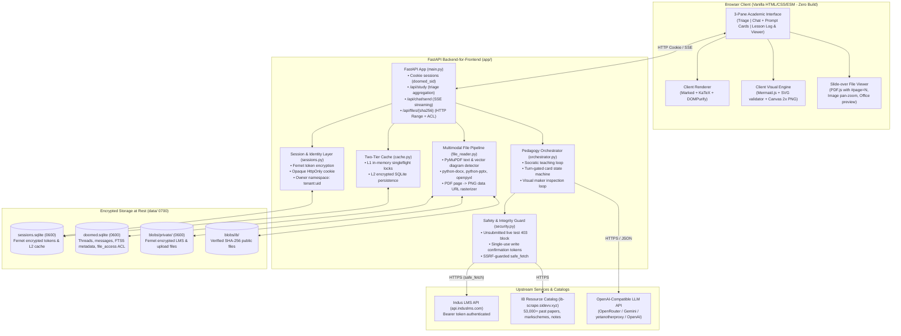

# Architecture & Deployment · doom-ed

This document details the system design, security boundary, data isolation, and deployment blueprint for **doom-ed**.

---

## 1. System Architecture



---

## 2. Multi-Tenant Security & Storage Isolation

1. **Owner Scoping (`tenant:uid`)**:
   - Students at the same school share an Indus LMS `tenant`, but have distinct `uid`.
   - Every session, cache key, FTS5 metadata row, chat thread, and file ACL entry is strictly scoped by `owner = f"{tenant}:{uid}"`.
   - Student A cannot view or search Student B's courses, files, grades, or chat threads even within the same tenant.
2. **Mandatory File ACL Gate (`file_access` Table)**:
   - File downloads via `/api/files/{sha256}` and document reading tools (`read_document`, `search_within_document`, `inspect_document_pages`) execute:
     ```sql
     SELECT 1 FROM file_access WHERE owner = :owner AND sha256 = :sha256
     ```
     (unless `source_type == 'ib'`). Attempting to access another student's file returns `403 Forbidden`.
3. **Encryption at Rest**:
   - `data/sessions.sqlite` and `data/doomed.sqlite` are created with `0600` permissions.
   - LMS access/refresh tokens, L2 cache payloads, private LMS files on disk (`data/blobs/private/{sha[:2]}/{sha}.enc`), and extracted page text in `file_pages` are encrypted with **Fernet** using a 32-byte key derived from `DOOMED_SECRET_KEY`.
4. **SSRF Hardening (`safe_fetch`)**:
   - Outbound file fetches enforce HTTPS on port 443, reject URL userinfo, resolve DNS via `socket.getaddrinfo`, and block loopback, private, link-local, multicast, and cloud metadata IPs (`169.254.169.254`, `127.0.0.0/8`, `10.0.0.0/8`, `172.16.0.0/12`, `192.168.0.0/16`, `::1`, `fc00::/7`) on initial requests and every redirect hop.
5. **Academic Integrity Protection**:
   - Unsubmitted or in-progress EOL tests and assessments cannot be explained or answered by the model. The server inspects submission status and raises `PermissionError` (mapping to HTTP 403), offering syllabus pointers and IB practice bank material instead.

---

## 3. Deployment Blueprint

### A. Main Backend & Web UI: Google Cloud Run (Free Tier Friendly)

The main application container runs on **Google Cloud Run** behind Cloudflare.

#### Free Tier Limits:
- **Cloud Run**: 2 million requests/month, 360,000 GB-seconds memory, 180,000 vCPU-seconds.
- **Google Cloud Storage (GCS)**: 5 GB Standard storage.

#### Dockerfile:
```dockerfile
# syntax=docker/dockerfile:1
FROM python:3.11-slim AS builder

WORKDIR /app
COPY requirements.txt .
RUN pip install --no-cache-dir -r requirements.txt

FROM python:3.11-slim
WORKDIR /app
COPY --from=builder /usr/local /usr/local
COPY app/ app/
COPY web/ web/
COPY COPYING .

ENV DOOMED_DATA_DIR=/srv/data
RUN mkdir -p /srv/data && chmod 700 /srv/data

EXPOSE 8080
CMD ["uvicorn", "app.main:app", "--host", "0.0.0.0", "--port", "8080"]
```

#### Persistent SQLite Replication with Litestream:
Because Cloud Run container instances have ephemeral filesystems, SQLite databases (`data/sessions.sqlite`, `data/doomed.sqlite`) are continuously replicated to Google Cloud Storage via **Litestream**:
```yaml
# litestream.yml
dbs:
  - path: /srv/data/sessions.sqlite
    replicas:
      - url: gcs://doomed-sessions-backup/sessions.sqlite
  - path: /srv/data/doomed.sqlite
    replicas:
      - url: gcs://doomed-sessions-backup/doomed.sqlite
```
On container start, `litestream restore -if-replica-exists` restores the databases before launching `uvicorn`.

---

### B. IB Resource Catalog Sidecar: Vercel Serverless (Free Tier)

The IB resource catalog (`ib-resource-scraping`) is hosted serverless at `https://ib-scrape.sidevv.xyz`:
- Read-only search and facets over committed JSON manifests (`manifests/*.json`).
- Downloads 307-redirect directly to upstream mirror URLs (zero bandwidth cost on Vercel).
- Vercel Free Tier: 100 GB bandwidth, 1,000,000 edge/serverless requests/month.

---

### C. LLM Integration & Routing

doom-ed connects to any OpenAI-compatible API endpoint:
- **OpenRouter**: Access to `google/gemini-2.5-pro` (Teacher), `google/gemini-2.5-flash` (Maker/Researcher), or `anthropic/claude-3.5-sonnet`.
- **Gemini via Google AI Studio**: Direct OpenAI-compatible endpoint at `https://generativelanguage.googleapis.com/v1beta/openai/` using Gemini 2.5 Pro / Flash.
- **Local / Self-hosted proxy**: `yetanotherproxy` or LiteLLM.

Runtime model configurations can be adjusted without restarting the container via the in-app **Settings modal** (`POST /api/settings`).
