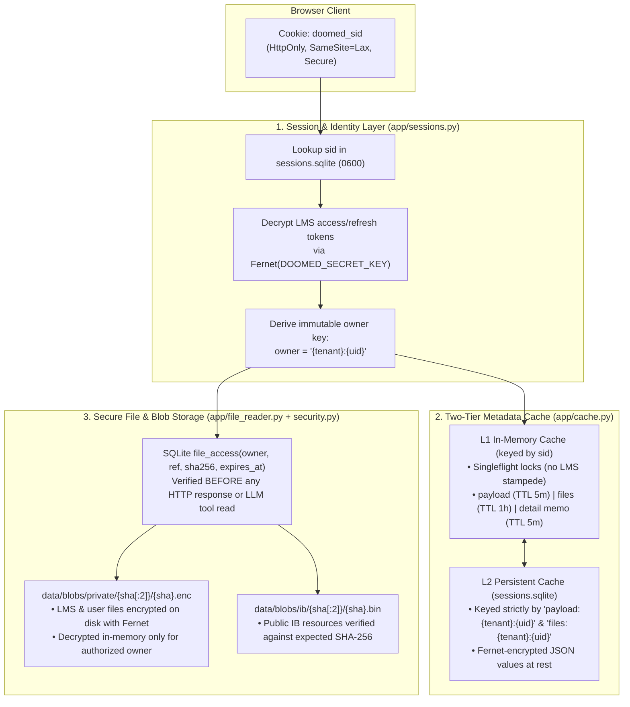

# INIT · doom-ed

Standalone AI Study Coach and Pedagogy Web Application grounded in live **Indus LMS** student data (`StrangeSid/induslms-agent`), the **53k+ IB Resource Catalog** (`StrangeSid/ib-resource-scraping`), and the **Dependency-Graph Teaching & Visual Verification System** (`StrangeSid/learning-agent` / `amosblomqvist/learn`), following the product specification in `StrangeSid/openLMS-indus/ROADMAP.md`.

This file is the design brief. For the running system, see `ARCHITECTURE.md` (how it works and how it deploys), `DOCS.md` (every endpoint and agent tool), and `README.md` (how to run it).

---

## 1. Core Principles & Non-Negotiable Constraints

1. **Zero Synthetic / Demo Data**:
   - No fake courses, no mock assignments, no fallback fixtures.
   - Either live Indus LMS data is pulled using an authenticated student session (`lms.py` / `~/.induslms_token.json`), or endpoints return `401 Unauthorized` and the UI prompts the student to sign in.
2. **No Build Step (Vanilla Web Stack)**:
   - Plain HTML, CSS, and ES modules in `web/`.
   - Rich client-side rendering via Marked (Markdown + Obsidian callouts), KaTeX (`$...$` and `$$...$$`), Mermaid.js (live SVG diagrams), raw SVG, and the slide-over file viewer (`viewer.js`).
3. **BFF Only (Backend-for-Frontend)**:
   - Browser never calls `api.induslms.com` directly (origin-bound tokens & CORS). All LMS, IB catalog, file-reading, and LLM calls go through the FastAPI server (`app/`).
   - Model routing is server-side too. The browser never supplies a provider, a key, or a model name.
4. **Academic Integrity & Ask-First Writes**:
   - **Never answer or submit live/unsubmitted tests**: Server inspects test/assessment submission status before any explanation or context injection. Unsubmitted EOL tests or assessments are rejected with `403 Forbidden` and redirected to syllabus pointers + IB practice bank equivalents.
   - **Ask-first writes**: Any LMS write (`submit`, `resubmit`, `request_extension`, `send_message`, `mark_read`) emits an interactive `<WriteConfirmCard>` with a one-time confirmation token, executes at most once, never auto-retries, and invalidates affected caches.
5. **Local-First Storage**:
   - Chats, messages, and files live on the student's own disk, partitioned by `owner = "{tenant}:{uid}"`. Indus LMS and the IB catalog are read live and never stored.
   - Two students on one machine never see each other's work.

---

## 2. Project Structure

```text
/Users/sid/Documents/proj/doom-ed/
├── INIT.md                    # This design brief
├── .gitignore                 # Excludes .env, config.json, data/, *.db*, .venv/
├── .env.example               # Template for secrets, model routing, IB URL, cache limits
├── config.example.json        # Model routing template (real config.json stays gitignored)
├── requirements.txt           # FastAPI, uvicorn, requests, cryptography, pymupdf, python-docx, python-pptx, openpyxl
├── app/
│   ├── __init__.py
│   ├── main.py                # FastAPI entrypoint, static mounts, auth/session routes, SSE chat & blob routes
│   ├── config.py              # Environment config, TTL settings, byte limits, model routing
│   ├── sessions.py            # Opaque HttpOnly cookie sessions + 0600 SQLite store + Fernet encryption at rest
│   ├── cache.py               # Per-student L1 in-memory cache (singleflight, mixed TTLs) + L2 encrypted SQLite cache
│   ├── db.py                  # SQLite schema: threads, messages, file ACLs, FTS5 indices, visual store
│   ├── security.py            # SSRF guard (safe_fetch), Fernet cipher, write confirmation tokens
│   ├── lms_bridge.py          # Indus LMS client wrapper, /api/study triage builder, background course file crawler
│   ├── ib_client.py           # Client for https://ib-scrape.sidevv.xyz (/search, /facets, /resources, paper+MS pairing)
│   ├── file_reader.py         # Unified file fetcher, encrypted/public blob cache, PyMuPDF + Office text/vision extractor
│   ├── prompts.py             # Vendored system prompts: teach, visualize, mermaid-maker, svg-maker, researcher
│   ├── orchestrator.py        # Streaming multi-turn agent loop, tool router, card pause/resume, maker vision loop
│   └── research.py            # Web search & fetch tools for the researcher subagent
├── web/
│   ├── index.html             # 3-pane layout: Triage & Fix-List | Pedagogy Chat & Prompt Cards | Lesson Log & Viewer
│   └── assets/
│       ├── style.css          # Academic UI styles, Obsidian callout themes, prompt cards, diagram frames
│       ├── app.js             # Auth flow, triage loader, SSE stream client, thread switcher, re-auth banner
│       ├── renderer.js        # Markdown + DOMPurify + KaTeX + Obsidian callouts + citation deep-links
│       ├── cards.js           # <QuizCard> (shuffled + pinned 0: "I don't know"), <AskCard>, <WriteConfirmCard>
│       ├── viz-engine.js      # Browser Mermaid/SVG renderer, getBBox() layout validator, <canvas> PNG rasterizer
│       ├── viewer.js          # In-app slide-over file viewer (PDF.js with #page=N jump, images, DOCX, XLSX, PPTX)
│       ├── log-export.js      # Live Obsidian callout + LaTeX lesson log builder & 1-click clipboard/markdown export
│       └── vendor/            # Local copies of marked, KaTeX, DOMPurify, Mermaid (CDN fallback only)
├── data/                      # Gitignored runtime storage (0700 permissions)
│   ├── sessions.sqlite        # 0600 session + encrypted L2 payload/files cache
│   ├── doomed.sqlite          # 0600 threads, FTS5 indices, file metadata, per-owner ACL table
│   ├── blobs/
│   │   ├── private/           # Fernet-encrypted LMS & user-uploaded blobs ({sha256[:2]}/{sha256}.enc)
│   │   └── ib/                # Public IB catalog blobs verified against upstream SHA-256
│   ├── renders/               # Encrypted temporary PDF page rasterizations for vision inspection
│   └── viz/                   # Published SVG + PNG diagrams per thread
└── tests/
    ├── test_security_cache.py     # Cross-student isolation, Fernet encryption at rest, SSRF guard, TTL eviction
    ├── test_security_hardening.py # Regression tests for each closed vulnerability
    ├── test_session_expiry.py     # Expired-token behaviour: stale data served, re-auth demanded
    ├── test_lms_bridge.py         # Live LMS bridge, triage calculation, write confirmation
    ├── test_ib_client.py          # IB paper+markscheme pairing
    ├── test_file_reader.py        # PDF/DOCX/PPTX/XLSX parsing, FTS page search, ACL check, vision rendering
    ├── test_orchestrator.py       # Quiz/Ask state machine, card round trip, maker DOM+vision loop
    ├── test_prompts.py            # Prompt integrity and web search
    ├── test_api.py                # FastAPI endpoint integration
    ├── test_e2e_playwright.py     # Browser tests for auth, triage, cards, viewer
    └── test_frontend_xss.py       # Proof that LMS and model text cannot inject markup
```

---

## 3. Caching & File Security Architecture

Because school LMS data contains personal grades, teacher feedback, and grade-restricted course materials, caching and file storage enforce strict **multi-tenant / per-student isolation** and **encryption at rest**.



### 3.1 Session & Token Security (`app/sessions.py`)
- **Opaque Session ID**: Browser holds only a 32-byte random `doomed_sid` in an `HttpOnly`, `SameSite=Lax` (`Secure` on HTTPS) cookie. Tokens never touch `localStorage` or client JS.
- **Encrypted Token Persistence**: `data/sessions.sqlite` is created with `0600` file permissions inside `data/` (`0700`). LMS `access` and `refresh` tokens (or imported `~/.induslms_token.json` credentials) are encrypted with **Fernet** (`cryptography.fernet.Fernet`, key derived from `DOOMED_SECRET_KEY`).
- **Instant Revocation**: Sign-out (`POST /api/logout`) deletes the session row, clears the L1 memory cache, and invalidates active stream tokens.

### 3.2 Per-Student Isolation & Multi-Tier Caching (`app/cache.py`)
- **Owner Namespace (`{tenant}:{uid}`)**:
  - Never cache by `tenant` alone (all students at a school share `tenant`). Every cache key, FTS5 row, and file ACL entry is keyed by `owner = f"{tenant}:{uid}"`.
- **L1 In-Process Cache (Fast Path)**:
  - Per-student `_Entry` with singleflight locks (`lock`, `crawl_lock`, `revalidate_lock`) so parallel chat tool calls and UI refreshes share one upstream LMS fetch.
  - **Mixed TTLs**:
    - `DATA_TTL = 300s`: Courses, EOL list, FA/SA assessments, learning tasks, calendar, notifications.
    - `FILES_TTL = 3600s`: Recursive course folder crawl (`list_resources` + `resource_children`), executed in a background singleflight worker so chat/dashboard loads never block on deep folder trees.
    - `DETAIL_TTL = 300s`: Individual graded EOL results, FA rubric/submission details, and `/api/study` triage output.
- **L2 Persistent Encrypted Cache (Warm Restart)**:
  - Stores `payload:{tenant}:{uid}` (`TTL = 3600s`) and `files:{tenant}:{uid}` (`TTL = 86400s`) encrypted via Fernet in `sessions.sqlite`.
  - Supports `ETag` / `If-None-Match` (`304 Not Modified`) and stale-while-revalidate.
- **Write-Triggered Cache Invalidation**:
  - Confirmed LMS writes immediately purge affected L1 detail prefixes and L2 payload entries.

### 3.3 File Storage Security, Encryption at Rest & Access Control (`app/file_reader.py` & `app/security.py`)
1. **Strict Separation of Private LMS Files vs Public IB Files**:
   - **Private Files (`lms://...`, `upload://...`)**:
     - Stored under `data/blobs/private/{sha256[:2]}/{sha256}.enc`.
     - **Encrypted at rest** using Fernet before writing to disk. Raw PDF/DOCX/PPTX bytes never sit in plaintext on disk.
     - Extracted page text in `file_pages` is associated with an `owner`-scoped ACL check.
   - **Public IB Files (`ib://{sha256}`)**:
     - Fetched from `https://ib-scrape.sidevv.xyz/download/{sha256}`.
     - Verified on download that `hashlib.sha256(data).hexdigest() == sha256` before storing in `data/blobs/ib/{sha256[:2]}/{sha256}`.
2. **Mandatory Per-Owner ACL Gate (`file_access` Table)**:
   - Knowing or guessing a `sha256` or `ref` grants **zero access** to private files.
   - When an authenticated student's crawler or fetch pulls `lms://resource/{rid}/{fid}`, the server records `INSERT INTO file_access (owner, ref, sha256, filename, mime, updated_at)`.
   - Both `GET /api/files/{sha256}` (used by `viewer.js`) and agent tools (`read_document`, `search_within_document`, `inspect_document_pages`) execute:
     ```sql
     SELECT 1 FROM file_access WHERE owner = :owner AND sha256 = :sha256
     ```
     (unless `source_type = 'ib'`). If no row matches `owner`, the server returns `403 Forbidden`.
   - Grade restriction check (`_is_allowed_grade(file_grade, student_grade)`) runs before indexing or fetching any LMS course resource.
3. **SSRF & Upstream Fetch Hardening (`_safe_fetch`)**:
   - All outbound file fetches enforce `https://` on port `443`, reject URL userinfo, resolve DNS via `socket.getaddrinfo`, and block loopback, private, link-local, multicast, and cloud metadata IPs (`169.254.169.254`, `127.0.0.0/8`, `10.0.0.0/8`, `172.16.0.0/12`, `192.168.0.0/16`, `::1`, `fc00::/7`) on the initial request and every `30x` redirect hop.
   - Enforces `MAX_FILE_BYTES = 25 * 1024 * 1024` (25 MB streaming cap) and sanitizes `Content-Disposition` filenames.
   - Responses for private LMS files carry `Cache-Control: private, no-store`, `X-Content-Type-Options: nosniff`, and `Content-Security-Policy: default-src 'none'; style-src 'unsafe-inline'; img-src data: blob:;`.
4. **Bounded Disk Cache & Automatic Purge**:
   - Background/startup sweeper enforces `MAX_PRIVATE_CACHE_MB` (default `512 MB`, TTL `24h`) and `MAX_IB_CACHE_MB` (default `1024 MB`, LRU eviction), removing expired encrypted blobs and rendered page PNGs (`data/renders/`).

---

## 4. Autonomous File Discovery & Multimodal Reading Pipeline

### 4.1 Agent Discovery & Selection Tools
- `search_lms_files(query, subject?, ext?, limit=15)` — Queries the student's `owner`-scoped FTS5 metadata index (`title`, `filename`, `folder_path`, `subject`, `teacher`).
- `browse_lms_folder(course_id?, folder_id?)` — Lists folders and files in a specific course unit.
- `search_ib_resources(query, rtype?, level?, year?, session?, limit=10)` — Queries live `ib-scrape.sidevv.xyz/search` and auto-pairs past papers (`rtype=paper`) with their matching markscheme (`rtype=markscheme`).
- `select_and_attach_files(refs[])` — Fetches selected `lms://` or `ib://` refs into the secure blob store, attaches them to the active chat thread, indexes their pages, and pushes a live `file_attached` chip to the chat window.

### 4.2 Agent Document Reading & Vision Tools
- `search_within_document(ref, query, top_k=5)` — Searches per-page/per-slide text inside an attached/selected file and returns matching page numbers + snippets.
- `read_document(ref, pages="1-5")` — Decrypts blob in-memory and extracts structured Markdown text per page/slide/sheet (`PyMuPDF` for PDFs, `python-docx` for DOCX paragraphs + tables, `python-pptx` for slides, `openpyxl` for spreadsheets), plus `has_diagrams: bool` per PDF page.
- `inspect_document_pages(ref, pages=[2, 3], dpi=150)` — Renders specified PDF pages to PNG in memory via `PyMuPDF` and passes `data:image/png;base64,...` to the vision-capable LLM so it can read circuit diagrams, geometry figures, graphs, and markscheme tables.

---

## 5. Pedagogy Engine & Web Chat Workflow

1. **Triage Briefing (`/api/study`)**:
   - Computes from live LMS data:
     - **Now**: Overdue → due today/tomorrow → today's calendar → unread notifications.
     - **Weak at**: Wrong answers from graded EOL tests (`lms.eol_detail`), lowest rubric rows from graded FA/SA assessments (`lms.fa_detail`), and teacher task feedback.
     - **Before next break**: Ordered work queue before the next calendar holiday/break.
2. **3-Phase Teaching Loop (`app/prompts.py` + `app/orchestrator.py`)**:
   - **Phase 1 — Probe**: Graded `<QuizCard>` calls (options shuffled, index `0: "I don't know"` pinned at bottom, correct answer held server-side until submission) to bracket the student's knowledge edge, followed by one ungraded `<AskCard>` to lock the session goal.
   - **Phase 2 — Plan**: Optional `researcher` subagent + LMS/IB syllabus lookup → concise plan + Mermaid dependency graph (`graph TD`) → `<AskCard>` wait for student approval.
   - **Phase 3 — Teach Loop**: One dependency-graph node at a time (**Motivate → Establish → Connect → Calibrated `<QuizCard>` check**). Never advances past a missed or `"I don't know"` check.
3. **Web-Native Visual Maker Loop (`viz-engine.js` + Maker Subagents)**:
   - Teacher dispatches `mermaid-maker` or `svg-maker` with a pruned brief ($\le 5\text{–}7$ elements).
   - Browser offscreen-renders the Mermaid/SVG, validates syntax and `getBBox()` clipping/text-overlap, rasterizes a `<canvas>` PNG, and sends it back to the Maker vision model to inspect and iterate before publishing into the chat bubble.
4. **Live Obsidian Lesson Log (`log-export.js`)**:
   - Mirrors user prompts, teaching prose, `> [!question]`, `> [!success]`/`> [!failure]` quiz blocks, inline `$...$` LaTeX, and published visuals into Obsidian-compatible Markdown for 1-click copy or `.md` download.

---

## 6. Implementation Order (When Triggered)

1. **Step 1 — Security, Sessions, Cache & DB (`app/config.py`, `sessions.py`, `cache.py`, `security.py`, `db.py`)**
2. **Step 2 — Live LMS Bridge, IB Client & Secure File Reader (`app/lms_bridge.py`, `ib_client.py`, `file_reader.py`)**
3. **Step 3 — Pedagogy Prompts, Orchestrator & FastAPI Routes (`app/prompts.py`, `orchestrator.py`, `research.py`, `main.py`)**
4. **Step 4 — Frontend UI, Rich Renderer, Prompt Cards, Visual Engine & File Viewer (`web/index.html`, `web/assets/*.js`, `style.css`)**
5. **Step 5 — Security, Caching, Safety & End-to-End Tests (`tests/`)**
