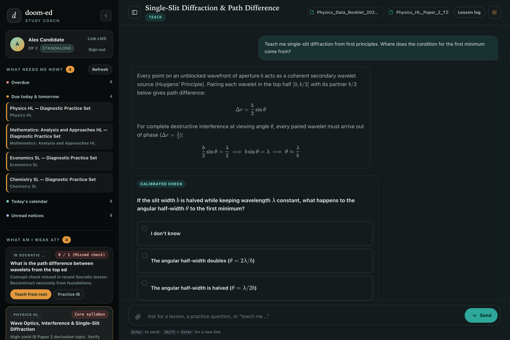

# doom-ed

An offline-first AI study coach for the International Baccalaureate that pairs a 53,000+ IB resource bank with a Socratic tutoring engine, turn-gated concept checks, an in-app document viewer, and optional live Indus LMS sync.



---

## Why this exists

Studying for the International Baccalaureate while keeping up with school tasks usually means keeping twenty tabs open:
- Past paper mirrors for exam questions and markschemes
- Subject syllabi and formula booklets
- Chatbots that either hallucinate answers or lecture without checking if the foundation actually clicked
- School LMS portals for daily tasks, end-of-lesson (EOL) tests, and rubric feedback

Doom-ed turns that scattered workflow into a single local surface. It functions out of the box for any IB student as an independent study coach, and optionally connects to Indus LMS to pull in school assignments, calendar deadlines, and graded test results.

---

## How it works

### 1. Standalone IB study triage & optional school sync
doom-ed builds an immediate three-pane study triage:
- **What needs me now**: Curated past paper diagnostic sets for your enrolled IB DP subjects, exam countdown, and (when linked) live school assignments, today's timetable, and unread notifications.
- **What am I weak at**: Tracks your misses across interactive Socratic lesson quizzes and syllabus fundamentals. When Indus LMS is linked, it also inspects graded school EOL tests and formative assessments to extract missed questions and rubric criteria into your fix list.
- **Before next break**: Upcoming IB preparation milestones (timed Paper 1 diagnostics, Paper 2 derivations, formula derivations) and upcoming school calendar deadlines.

No synthetic demo mocks. Operates 100% standalone out of the box, with zero LMS credentials required.

### 2. Socratic teaching engine
Based on the dependency-graph pedagogy from `amosblomqvist/learn`:
- **Unconditional truths first**: Establishes core definitions and universal statements before introducing nuance or edge cases.
- **Why before what**: Motivate $\to$ Establish $\to$ Connect. Reconstructs why a formula or rule had to be this way before naming it.
- **3-Phase loop**:
  1. *Probe*: Binary-searches your prior knowledge using fast multiple-choice questions.
  2. *Plan*: Builds a dependency map showing the steps from your current edge to the goal, and pauses for your approval.
  3. *Teach*: Walks each node one at a time (Motivate $\to$ Establish $\to$ Connect $\to$ Calibrated check). Never advances past a missed concept.

### 3. Turn-gated prompt cards
Interactive cards are embedded directly in the chat stream:
- **`<QuizCard>`**: Real options are shuffled on every render with a pinned `0: "I don't know"` choice at the bottom. Correct answers stay server-side until you submit, preventing answer leaks. Instant feedback shows whether you passed, missed, or flagged uncertain.
- **`<AskCard>`**: Single or multi-choice questions with an inline "Other (type your own)" field for goal setting and plan adjustments.
- **`<WriteConfirmCard>`**: School writes (marking notifications read, sending teacher notes, extension requests, task submissions) require explicit confirmation and can't auto-execute.
- **`<VisualCard>`**: Embeds generated Mermaid and SVG diagrams verified through an offscreen browser geometry check.

### 4. Multimodal document reader & viewer
LMS handouts and IB exam papers live in the slide-over file viewer (`viewer.js`):
- Reads PDFs (with page text streaming and TOC navigation), DOCX (parsed to Markdown tables), PPTX (slides + speaker notes), and XLSX spreadsheets.
- Uses PyMuPDF to rasterize PDF pages containing vector drawings or graphs into PNG data URLs, letting vision-capable LLMs read equations, circuit diagrams, and markscheme tables directly.
- Bidirectional citations: clicking a citation link in chat jumps the viewer to that exact page (`#page=N`); clicking **"Ask about Page N"** in the viewer attaches that page directly into the chat prompt.

### 5. 53,000+ IB resource catalog
Queries the public catalog at `https://ib-scrape.sidevv.xyz`:
- Past papers, markschemes, question banks, subject guides, and student notes.
- Automatically pairs question papers (`rtype=paper`) with their official markschemes (`rtype=markscheme`) matching subject, level (HL/SL), session (May/Nov), year, paper number, and timezone.

### 6. Live Obsidian lesson log
Every explanation, diagram, and quiz check mirrors live into an Obsidian-style Markdown log with native callouts (`> [!question]`, `> [!success]`, `> [!failure]`), LaTeX math (`$...$`), and diagram embeds (`![[slug.png|550]]`). Copy to clipboard or download as `.md` with one click.

---

## Local-first architecture & security

Doom-ed is built to run locally on your machine:
- **Data isolation**: All chat threads, message histories, and file metadata are saved in a local SQLite database (`data/doomed.sqlite`) with `0600` file permissions. Queries are strictly scoped to your student ID (`tenant:uid`).
- **Encrypted at rest**: Session tokens, cached payloads, and private school handouts are encrypted on disk with Fernet.
- **Zero test leaks**: The server verifies assignment submission state before answering. Any in-progress or unsubmitted EOL test returns `403 Forbidden` and redirects to syllabus practice instead.
- **Server-side model routing**: The browser never asks for an API key or provider endpoint. LLM routing is configured on the backend via `config.json`.

---

## Quick start

### Prerequisites
- Python 3.10+
- [uv](https://github.com/astral-sh/uv) (recommended) or standard `pip`
- Google Chrome or Chromium (for Playwright browser tests and diagram verification)

### Installation

```bash
git clone https://github.com/StrangeSid/doom-ed.git
cd doom-ed

uv venv .venv
source .venv/bin/activate
uv pip install -r requirements.txt -r requirements-dev.txt

cp .env.example .env
cp config.example.json config.json
```

### Configuration

Edit `config.json` with your OpenAI-compatible endpoint:

```json
{
  "llm": {
    "base_url": "http://localhost:20128/v1",
    "api_key": "your-api-key",
    "teacher_model": "agy/gemini-3.8-flash-high",
    "maker_model": "agy/gemini-3.8-flash-high",
    "researcher_model": "agy/gemini-3.8-flash-high"
  }
}
```

Works with OmniRoute, OpenRouter, Gemini via Google AI Studio, or any local proxy.

### Running

```bash
uvicorn app.main:app --host 127.0.0.1 --port 8000 --reload
```

Open `http://127.0.0.1:8000`:
- Click **"Start Independent IB Study"** to immediately launch your personalized IB coaching session.
- Or click **"Sign in with Indus LMS"** (or use local `~/.induslms_token.json`) to sync live school assignments and calendar events.

---

## Testing

```bash
# Run full unit and integration suite (159 tests)
pytest

# Run Playwright browser tests
pytest tests/test_e2e_playwright.py tests/test_frontend_xss.py
```

---

## Repository layout

```text
doom-ed/
├── app/
│   ├── main.py              # FastAPI server, SSE stream, viewer endpoints
│   ├── orchestrator.py      # Socratic teaching loop & card state machine
│   ├── lms_bridge.py        # Live Indus LMS client, triage builder, crawler
│   ├── file_reader.py       # Blob storage, PyMuPDF + Office parsers, vision rasterizer
│   ├── ib_client.py         # IB catalog search & paper-markscheme pairing
│   ├── prompts.py           # Teach & visualize prompts (ported from learning-agent)
│   ├── security.py          # Fernet cipher, SSRF safe_fetch guard, write tokens
│   ├── sessions.py          # SessionStore in 0600 SQLite with token encryption
│   ├── cache.py             # L1 in-memory singleflight + L2 encrypted cache
│   ├── config.py            # config.json loader & runtime overrides
│   └── db.py                # Local SQLite database (threads, messages, ACLs)
├── web/
│   ├── index.html           # 3-pane interface (Triage | Chat | Viewer & Log)
│   └── assets/
│       ├── app.js           # Client controller, SSE consumer, modal handlers
│       ├── cards.js         # Interactive <QuizCard>, <AskCard>, <WriteConfirmCard>
│       ├── viewer.js        # Slide-over in-app viewer (PDF.js, pan-zoom, Office)
│       ├── viz-engine.js    # Client-side Mermaid + SVG renderer & validator
│       ├── renderer.js      # Marked + KaTeX ($/$$) + Obsidian callouts + DOMPurify
│       ├── log-export.js    # Live Obsidian lesson log builder & exporter
│       ├── style.css        # Academic UI design system with light/dark themes
│       └── vendor/          # Vendored browser assets (Mermaid, KaTeX, Marked, DOMPurify)
├── docs/
│   └── assets/
│       └── homepage.png     # Live UI screenshot
├── tests/                   # 155 unit, security, and Playwright tests
├── ARCHITECTURE.md          # Deployment & cloud architecture
├── DOCS.md                  # Detailed API & tool reference
├── CONTRIBUTING.md          # Contributing guidelines
├── CHANGELOG.md             # Version history
└── COPYING                  # GNU General Public License v3.0
```

---

## License

GNU General Public License v3.0 or later ([COPYING](COPYING)).
